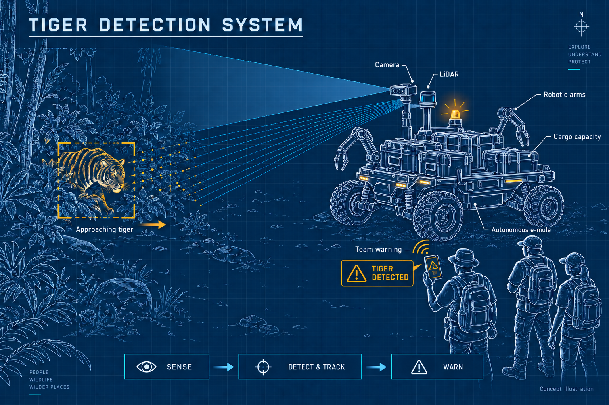
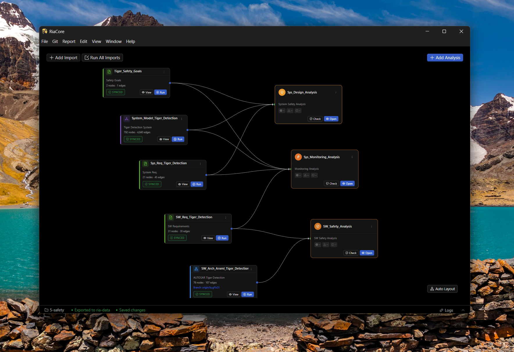

# RiaCore Application Demo Project

This is the demo project for the [RiaCore application](https://github.com/cntSafety/RiaCore).
It provides the starting point for the training and needs to be finalized during
the training through requirements review, safety analysis, and validation of the
proposed safety measures.

The example is a tiger detection system that protects an exploration team. A
vehicle transports the team's equipment and carries camera and lidar sensors to
detect approaching tigers and warn the explorers. The illustration shows this
basic concept; the project also explores additional sensing and safety measures.

## Layout

| folder | contents |
|---|---|
| `0-safety-goals` | safety goals (sphinx-needs) |
| `1-sys-req` | system requirements (sphinx-needs) |
| `2-sys-design` | system design (SysML v2) |
| `3-sw-req` | SW requirements (sphinx-needs) |
| `4-sw-arch-arxml` | SW architecture (ARXML) |
| `5-safety` | ready-made RIA workspace |
| `build_scripts` | build tooling and setup documentation |

For build setup and usage, see the [build scripts README](build_scripts/README.md).

## Getting started

1. Install RiaCore following the instructions in its repository.
2. Add the importers to load this project's data using **Add Import** on the start screen.
3. Use **Add Analysis** to perform the safety analysis and complete the project during training.

Alternatively, open the ready-made workspace in `5-safety` directly using
**File → Open Workspace** and continue the training from there.

